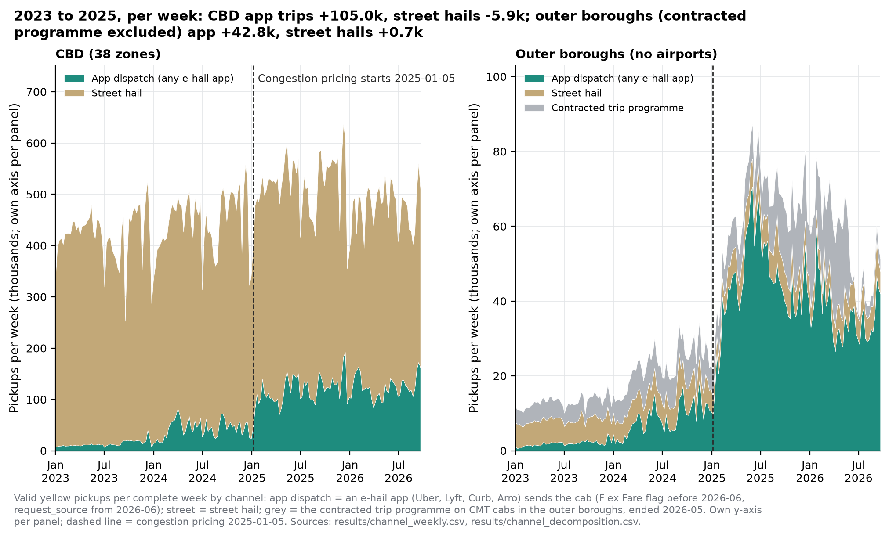
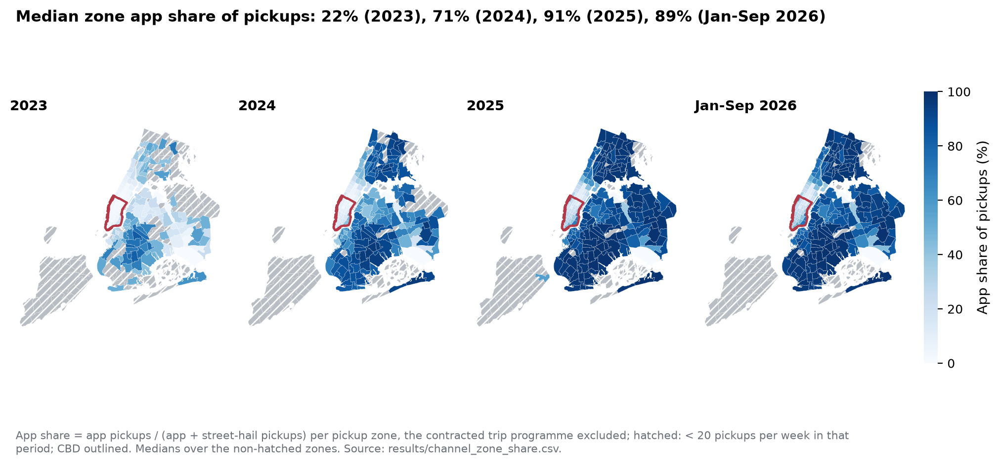
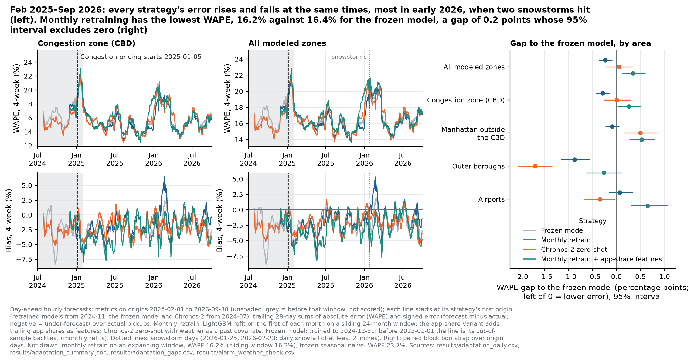

# Where the Growth Came From: App Dispatch and NYC Yellow Cabs, 2023–2026

**Status: Phase 7 draft (Checkpoint 7), not yet reviewed.** The full report is
[`reports/analysis.md`](reports/analysis.md); the specification is [`PLAN.md`](PLAN.md); every
judgement call is in [`DECISIONS.md`](DECISIONS.md); every number below comes from the
`results/` file linked next to it.

## Summary

From 2023 to 2025, NYC yellow-taxi pickups grew 27.3% (703,268 → 895,177 a week). App-dispatched
trips account for all of that growth (+199,068 a week); street hails changed by −7,159 (−1.1%)
([channel_decomposition.csv](results/channel_decomposition.csv),
[presentation_numbers.json](results/presentation_numbers.json)). In Manhattan's congestion zone
(CBD), app dispatch rose from 2.3% to 29.6% of yellow pickups between January 2023 and January
2026 ([channel_restatement.json](results/channel_restatement.json)). The fleet supplied more
cab-days at a steady intensity: trips per day rose 25.6% and active cabs per day 24.0% from 2023
to 2025, while trips per cab-day stayed between 14.0 and 15.0
([incrementality_dml.json → supply](results/incrementality_dml.json)). Whether the app trips are additional, and
what congestion pricing did to taxi demand, are not identified: every pre-registered design
failed its pre-trend gate or disagreed with the others, and each is reported as found. For
forecasting, monthly retraining gave the lowest error after January 2025 (WAPE 16.2% vs 16.4%
frozen); adding trailing app-share features did not remove the under-forecast
([adaptation_summary.json](results/adaptation_summary.json)).

## Figures

| The shift | Where | Incrementality | The −35% artefact | Forecasting |
|---|---|---|---|---|
| [](reports/figures/F6a_channel_areas.png) | [](reports/figures/F6b_app_share_maps.png) | [](reports/figures/F6c_incrementality.png) | [](reports/figures/F4d_counterfactual_vs_did.png) | [](reports/figures/F5_adaptation.png) |
| App vs street-hail pickups by area (D1) | App share and growth by zone | Not identified: estimators disagree (D2) | Frozen forecast vs the pre-registered DiD | Four adaptation strategies (Phase 5) |

All other figures are in [`reports/figures/`](reports/figures/); the interactive zone map is
[`F4b_effect_map.html`](reports/figures/F4b_effect_map.html). A Tableau Public dashboard is
specified in [`reports/dashboard_spec.md`](reports/dashboard_spec.md) (extracts:
`make tableau-extract`); its link is added once published.

The panel, the channel split and every heterogeneity cut are SQL models in dbt (window functions
over DuckDB), not pandas.

## Setup (WSL / Linux)

```bash
make setup        # uv: Python 3.12 venv in .venv, installs the package with [dev] extras
make smoke        # one sample month end to end: download -> dbt build+test -> backtest -> figure
make all          # everything below, in order (long: see Runtimes)
make verify PHASE=N
```

The system Python 3.14 is not supported (missing wheels); `make setup` uses `uv` to install 3.12.
Keep the repository and `data/` on the Linux filesystem, not under `/mnt/c/`. Long steps were run
under a memory cap (`systemd-run --user --scope -p MemoryMax=10G -p MemorySwapMax=0 ...`); DuckDB
uses `memory_limit = 5GB`, 10 threads.

## Make targets

| target | what it does |
|---|---|
| `smoke` | sample month (`smoke.month` in `config/project.yaml`) through the whole pipeline; writes `results/smoke/` and `reports/figures/smoke/`; fails if over `smoke.max_runtime_minutes` |
| `data` | full raw download (yellow months in config, zone lookups, weather) |
| `dbt` | build and test the DuckDB warehouse in two stages around the CBD mapping (`03a`), then the Phase-1 result files (`03b`) and Checkpoint-1 checks (`03c`) |
| `probes` | one-off evidence scripts behind DECISIONS.md entries (duplicates, negative fares, record formats, Open-Meteo offset) |
| `forecast` | Phase 2: LightGBM grid on 2023 (`04a`), rolling-origin backtests for 2023 and 2024 (`04`), conformal calibration and metrics (`04b`) |
| `chronos-bundle`, `chronos-import` | Phase 2: export the Chronos-2 input bundle for Colab; validate the forecasts copied back |
| `shock` | Phase 3: frozen LightGBM, day-ahead 2024-07 → 2026-09 without retraining, CUSUM and rolling-bias monitors (`06`); C5: the same monitor for three shocks (`06b`) |
| `causal` | Phase 4 / 4b: speed and demand DiD with checks and placebos, MDE, heterogeneity, counterfactual, test-size simulation, app-dispatch share, synthetic control (`07a`–`07f`) |
| `hvfhv` | Amendment 4: stream the high-volume FHV months (download → DuckDB aggregates → verify → delete; manifest `data/raw/hvfhv_manifest.csv`; stops below `hvfhv.min_free_gb` free on the drive named by `TAXI_SHOCK_DISK_GUARD`) (`11`) |
| `channel` | Amendment 4 / 4a: label validation D0 (`10a`), CMT contracted block (`10b`), channel decomposition D1 (`10c`), incrementality D2 (`12`), Lyft entry D3 (`13`), by-channel DiD D5 (`14`), app-share step D5b (`15`), cross-platform D4 (`17`), experiment design (`19`) |
| `fhv` | C6: congestion pricing and FHV demand, pre-trend gate first (`16`) |
| `lyft-refresh` | D3: re-download, rebuild and re-estimate once later TLC months are added to the config |
| `adapt` | Phase 5: S1 / S6 monthly refits and the S1e sensitivity (S1 on an expanding window), resumable per month; then evaluation of S0, S1, S4, S6, S1e and the seasonal-naive reference (`08`) |
| `figures` | every figure, from `results/` only (`09`) |
| `tableau-extract` | E2: CSV / GeoJSON extracts for the dashboard (`18`) |
| `report` | runtimes (`20` → `results/runtimes.json`), dashboard extracts, dead-link check of README and report (`21`) |
| `verify PHASE=N` | ruff, pytest, dbt test, and presence of the phase's result files (`config/phase_outputs.yaml`) |

## Hardware and runtimes

Local: WSL2 on Windows, 12 cores, 11.68 GiB RAM
([machine_resources.json](results/machine_resources.json)). Chronos-2 ran on a Colab NVIDIA L4.
From [runtimes.json](results/runtimes.json) (`measured` = compute time the pipeline recorded;
`log_span` = wall time of runs that went start to finish once):

| Step | Time |
|---|---|
| `make smoke` (one month, end to end) | 47.6 s |
| LightGBM grid on 2023 (Phase 2) | 31.8 min |
| LightGBM rolling-origin backtests, both windows (Phase 2) | 194.3 min wall |
| Seasonal-naive and statistical backtests (Phase 2) | 78.6 min wall |
| Chronos-2 inference, 2024-01 → 2026-09 daily origins, two variants (Colab L4) | 269.8 min |
| Frozen-model fit (Phase 3) | 10.9 min |
| Phase 5 monthly refits, 23 per strategy (S1 / S6 / S1e) | 166.1 / 137.4 / 301.7 min |
| Incrementality DML with 25 repetitions (D2) | 3.4 min wall |

The raw download and the HVFHV stream ran over several resumed sessions and have no single
runtime.

## Limitations

- **Yellow taxis only for demand.** Uber and Lyft enter only as aggregates (C6, D4); no FHV
  forecasting.
- **Weather.** One city-wide Open-Meteo point; observed weather is used as if it had been known
  at the forecast origin.
- **Channel label.** Before 2026-06 "app" rests on the Flex Fare flag; platform-level results
  exist only from 2026-06; codes A and CC are undetermined.
- **Supply.** No driver- or vehicle-level data; the supply view uses TLC monthly aggregates.
- **Causal claims.** Every observational design failed its pre-registered gate; nothing here
  states a causal effect of app dispatch or of congestion pricing.

## Chronos-2 on Colab

Chronos-2 runs only on a Colab GPU (T4/L4), from a bundle exported here; no credentials are
involved. Two runs use the same script (`scripts/05_chronos_colab.py`):

| Run | Origins | Bundle (`make chronos-bundle ...`) | Returned files go to |
|---|---|---|---|
| `main` | 2024-01-01 → 2026-09-30 | `data/processed/chronos_bundle.zip` | `results/` |
| `calib_2023` | 2023-10-01 → 2023-12-31 (calibration history only) | `RUN=calib_2023` → `data/processed/chronos_bundle_calib_2023.zip` | `data/chronos_inbox/calib_2023/` |

1. Upload the run's zip to Google Drive and unzip it there (one folder per run).
2. In a Colab GPU runtime: `!pip install chronos-forecasting==2.3.2`, mount Drive, then
   `!python <bundle>/05_chronos_colab.py --bundle <bundle> --out-dir <bundle>/out`
   (a separate `--out-dir` per run; after a disconnect the same command resumes from its chunks;
   `--profile N` times the stages at several batch sizes).
3. Download `chronos_forecasts.parquet`, `chronos_forecasts_post.parquet` and `chronos_run.json`
   to the run's folder above, then `make chronos-import` (main) or
   `make chronos-import RUN=calib_2023`, which validates the run against its own manifest.

## Layout

`config/` (all dates, thresholds, paths) · `dbt/` (dbt-duckdb project over the raw Parquet) ·
`src/taxi_shock/` (library) · `scripts/` (thin CLI entry points) · `tests/` · `results/`
(git-tracked outputs; every reported number comes from here) · `reports/` (analysis, figures,
dashboard specification and extracts) · `reviews/` (independent phase reviews).

## Data and licences

- **NYC TLC trip records** (yellow taxi; high-volume FHV as aggregates), the zone lookup and
  shapefile, and the TLC monthly industry reports: public data published by the NYC Taxi &
  Limousine Commission. Raw files go to `data/raw/` (git-ignored); `data/raw/manifest.csv` and
  `data/raw/hvfhv_manifest.csv` record what was fetched so `make data` / `make hvfhv` can
  re-fetch it.
- **Weather**: Open-Meteo historical archive API (CC BY 4.0).
- **60th Street geometry** for the CBD rule: OpenStreetMap contributors (ODbL), via Overpass.

**Why models start in 2022.** Yellow-taxi volume has not returned to its pre-COVID level: mean
daily pickups in 2024 were 48% of 2019 (`results/citywide_yearly.csv`, `ratio_to_2019` = 0.4816;
2022 and 2023 were at 0.4635 and 0.4488). Training data therefore start at `model_start =
2022-01-01`, after the 2020–2021 recovery, so the models learn the current regime.
