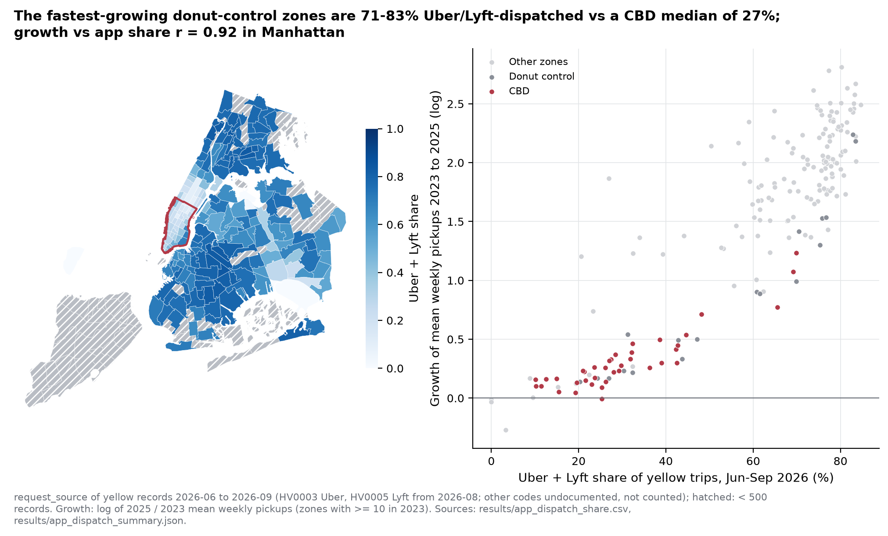
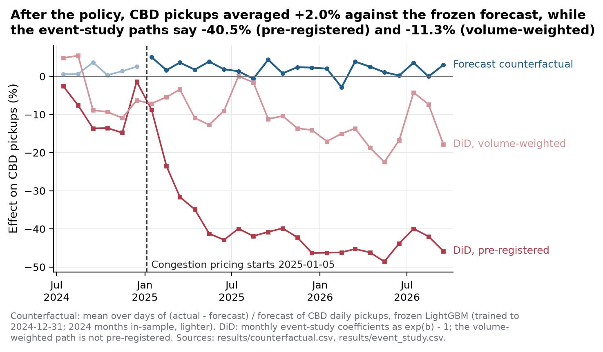

# Where the Growth Came From: App Dispatch and NYC Yellow Cabs, 2023–2026

[](https://github.com/stanley-zhou/nyc-yellow-cab-app-dispatch/actions/workflows/ci.yml)

From 2023 to 2025, NYC yellow-taxi pickups grew 27.3% (703,268 → 895,177 a week). App-dispatched
trips account for all of that growth (+199,068 a week); street hails changed by −7,159 (−1.1%)
([channel_decomposition.csv](results/channel_decomposition.csv),
[presentation_numbers.json](results/presentation_numbers.json)). App dispatch means an e-hail app
(Uber, Lyft, Curb, Arro) sends the cab. The full report is
[`reports/analysis.md`](reports/analysis.md), with details in
[`reports/appendix.md`](reports/appendix.md).

[](reports/figures/F0_citywide_channels.png)

| | |
|---|---|
| [](reports/figures/F4g_app_dispatch_map.png) | [](reports/figures/F4d_counterfactual_vs_did.png) |
| **Where it happened.** Zones where Uber and Lyft send yellow cabs are the zones where yellow pickups grew most. | **The −35% artefact.** A textbook difference-in-differences found a 35% drop that a forecast model did not see. |
| [](reports/figures/F6c_incrementality.png) | [](reports/figures/F5_adaptation.png) |
| **Are app trips additional?** Five estimators disagree beyond their intervals, so the data cannot say. | **Forecasting through the shift.** Every strategy errs at the same times; monthly retraining is slightly ahead. |

## Key results

- **Growth came from app dispatch.** Mean weekly yellow pickups +27.3% from 2023 to 2025; app
  trips +199,068 a week, street hails −7,159
  ([channel_decomposition.csv](results/channel_decomposition.csv)).
- **The app share rose in steps.** In the congestion zone (CBD) it went from 2.3% (January 2023)
  to 29.6% (January 2026) ([channel_restatement.json](results/channel_restatement.json)). At the
  largest step, in January 2025, app pickups rose 2.1- to 2.7-fold within two weeks in every area
  while street hails changed by −2.7% to +7.8%
  ([presentation_numbers.json](results/presentation_numbers.json)).
- **More cabs, not busier cabs.** From 2023 to 2025 trips per day rose 25.6% and active cabs per
  day 24.0%; trips per cab-day stayed between 14.0 and 15.0
  ([presentation_numbers.json](results/presentation_numbers.json)).
- **The −35% artefact.** The pre-registered difference-in-differences gave −34.6% for CBD pickups
  after congestion pricing; weighting zones by volume gives −5.2%, and the frozen forecast model
  +2.0% ([did_static.json](results/did_static.json),
  [figure_stats_phase4.json](results/figure_stats_phase4.json)).
- **The forecaster held up.** From February 2025 to September 2026, WAPE was 16.4% for the model
  frozen in December 2024, 16.2% with monthly retraining and 23.7% for a seasonal naive; the two
  2026 monitor alarms followed snowstorms ([adaptation_summary.json](results/adaptation_summary.json),
  [alarm_weather_check.csv](results/alarm_weather_check.csv)).

## What was tested and could not be identified

- Whether app trips are additional: estimates range from 0.52 to 2.62 across estimators in the CBD,
  and the lead placebo fails in Manhattan outside the CBD
  ([incrementality_dml.json](results/incrementality_dml.json)).
- What congestion pricing did to yellow demand, Uber and Lyft demand, or trip speed: every
  difference-in-differences fails its pre-trend test, and the synthetic control fails its
  fake-date check.
- Eight of ten pre-registered designs stopped at their pass/fail check; one passed and one passed
  on three of four outcomes, and neither identifies an effect ([presentation_numbers.json](results/presentation_numbers.json); report
  [section 4](reports/analysis.md#4-what-the-data-could-not-identify)).

## Methods and stack

- **SQL:** dbt on DuckDB, window functions; the panels, the channel split and every
  heterogeneity cut are SQL models, not pandas.
- **Snowflake:** the dbt models downstream of the cleaning run on Snowflake (dbt-snowflake,
  dialect macros) over the cleaned trips loaded with PUT / `COPY INTO`; 89/89 build steps and
  tests pass, and nine weekly, daily and hourly marts are identical to DuckDB's on the days
  both cover, within a relative tolerance of 1e-9 ([dbt_targets.json](results/dbt_targets.json)).
- **Python 3.12**, managed with uv.
- **Forecasting:** LightGBM quantile regression, Chronos-2 (zero-shot, on a Colab GPU), conformal
  prediction intervals.
- **Causal designs:** difference-in-differences and event studies (pyfixest), synthetic control
  (pysyncon), double machine learning (DoubleML).
- **Monitoring:** CUSUM drift detection.
- **Engineering:** pytest, ruff, GitHub Actions.
- **Dashboard:** Tableau.

## How the work was controlled

- Expected directions and pass/fail checks were written in [`PLAN.md`](PLAN.md) before each
  analysis.
- An independent review of every phase, with its fix rounds, is in [`reviews/`](reviews/), with
  the Checkpoint 7 advisor review.
- Every judgement call is logged in [`DECISIONS.md`](DECISIONS.md) (242 entries).
- 139 tests (pytest), dbt data tests and ruff run before every review (counts:
  [presentation_numbers.json → repository](results/presentation_numbers.json)).

## Dashboard

**[Open the Tableau Public dashboard](https://public.tableau.com/app/profile/stanley.zhou7746/viz/WheretheGrowthCameFrom-NYCYellowCabsandAppDispatch/Overview)** (version 1, one page: the headline tiles, citywide
weekly pickups by channel, the app share by area and a zone map of the app share). Specification and
what version 1 includes: [`reports/dashboard_spec.md`](reports/dashboard_spec.md); extracts:
`make tableau-extract`.

## Reproduce

### Setup (WSL / Linux)

```bash
git clone https://github.com/stanley-zhou/nyc-yellow-cab-app-dispatch.git
cd nyc-yellow-cab-app-dispatch
make setup        # Python 3.12 in .venv via uv, packages from the lock file (below)
make smoke        # one sample month end to end: download -> dbt build+test -> backtest -> figure
make all          # every step, in order (long: see Runtimes)
make verify PHASE=N
```

`make setup` runs the install from the lock file, which pins every package to the version that
produced `results/`:

```bash
uv python install 3.12
uv venv --python 3.12 .venv
uv pip sync --python .venv/bin/python requirements-dev.lock
uv pip install --python .venv/bin/python --no-deps -e .
```

For the Snowflake target, sync `requirements-snowflake.lock` instead (it adds `dbt-snowflake`);
the connection comes from `SNOWFLAKE_*` environment variables set outside the repository
(`src/taxi_shock/snowflake.py`, `dbt/profiles.yml`).
`pyproject.toml` holds the direct dependencies with exact pins; the lock files add every
transitive package. Python 3.11–3.12 is required (several dependencies ship no wheels for
3.14); [uv](https://docs.astral.sh/uv/) installs 3.12.
Keep the repository and `data/` on the Linux filesystem, not under `/mnt/c/`. Long steps were run
under a memory cap (`systemd-run --user --scope -p MemoryMax=10G -p MemorySwapMax=0 ...`); DuckDB
uses `memory_limit = 5GB`, 10 threads.

### Make targets

`make help` prints the same list.

| target | what it does |
|---|---|
| `help` | list every target with a one-line description |
| `setup` | Python 3.12 environment in .venv via uv, packages from requirements-dev.lock, the package itself editable |
| `smoke` | one sample month through the whole pipeline (download, dbt, backtest, figure); fails if over the time limit in config |
| `smoke-clean` | smoke run on a clean export of HEAD in a temporary directory; writes results/smoke/smoke_run_clean_clone.json |
| `data` | full raw download: every yellow-taxi month in config, the zone lookup and shapefile, hourly weather (01, 02) |
| `dbt` | build and test the DuckDB warehouse around the CBD zone mapping (03, 03a), then the data-quality results (03b) and the vendor, record-format, trip-level CBD-fee and modeled-zone checks (03c) |
| `probes` | one-off evidence scripts behind DECISIONS.md entries: duplicates, negative fares, record formats, weather time offset |
| `chronos-bundle` | export the Chronos-2 input bundle for Colab (05a); RUN=calib_2023 for the 2023 calibration run |
| `chronos-import` | validate the Chronos-2 forecasts copied back from Colab (05b); RUN=calib_2023 merges that run first |
| `figures` | report numbers and repository counts (23, results/presentation_numbers.json), then every figure from results/ (09) |
| `forecast` | LightGBM grid on 2023 (04a), rolling-origin backtests for 2023 and 2024 (04), conformal calibration and metrics (04b) |
| `shock` | frozen LightGBM day-ahead 2024-07 to 2026-09 with drift monitors (06), the same monitor for three shocks (06b), daily weather (06c) |
| `causal` | speed and demand difference-in-differences with placebos, detectable effect sizes, heterogeneity, counterfactual, app-dispatch share, synthetic control (07a-07f) |
| `hvfhv` | stream the high-volume FHV months: download, aggregate in DuckDB, verify, delete the raw file; manifest kept (11) |
| `channel` | app vs street-hail label check, contracted-trip block, growth decomposition, incrementality, Lyft entry, by-channel DiD, app-share steps, cross-platform view, experiment design (10a-19) |
| `fhv` | congestion pricing and high-volume FHV demand, pre-trend gate first (16; needs make hvfhv) |
| `lyft-refresh` | re-download, rebuild and re-estimate the Lyft entry after later TLC months are added to the config (01, 03, 13, 09) |
| `tableau-extract` | CSV and GeoJSON extracts for the Tableau Public dashboard in reports/tableau/ (18) |
| `adapt` | adaptation strategies: monthly retrain (S1), channel-aware forecaster (S6) and S1 on an expanding window (S1e), resumable per month, then their evaluation (08) |
| `snowflake` | load the cleaned trips to Snowflake (24), dbt build and tests there, DuckDB tests, per-target comparison (25); needs the Snowflake environment |
| `report` | runtimes (20, results/runtimes.json), dashboard extracts (18), dead-link check of the documents (21) |
| `all` | every step in order: data, dbt, forecast, shock, causal, hvfhv, channel, fhv, adapt, figures, report (long; hvfhv skips months already verified) |
| `verify` | make verify PHASE=N: ruff, pytest, dbt tests and presence of the phase's result files (config/phase_outputs.yaml) |
| `lint` | ruff over the repository |
| `test` | pytest |
| `clean-smoke` | delete the smoke warehouse and smoke outputs (regenerated by make smoke) |

### Hardware and runtimes

Local: WSL2 on Windows, 12 cores, 11.68 GiB RAM
([machine_resources.json](results/machine_resources.json)). Chronos-2 ran on a Colab NVIDIA L4.
From [runtimes.json](results/runtimes.json) (`measured` = compute time the pipeline recorded;
`log_span` = wall time of runs that went start to finish once):

| Step | Time |
|---|---|
| `make smoke` (one month, end to end) | 47.6 s |
| LightGBM hyperparameter grid on 2023 | 31.8 min |
| LightGBM rolling-origin backtests, both training windows | 194.3 min wall |
| Seasonal-naive and statistical backtests | 78.6 min wall |
| Chronos-2 inference, 2024-01 → 2026-09 daily origins, two variants (Colab L4) | 269.8 min |
| Frozen-model fit | 10.9 min |
| Monthly refits, 23 per strategy (monthly retrain / with app-share features / expanding window) | 166.1 / 137.4 / 301.7 min |
| Incrementality, double machine learning with 25 repetitions | 3.4 min wall |
| Snowflake load: export, PUT, `COPY INTO` ([snowflake_load.json](results/snowflake_load.json)) | 16.0 min |
| `dbt build` on Snowflake, X-Small ([dbt_targets.json](results/dbt_targets.json)) | 63.3 s |

The raw download and the HVFHV stream ran over several resumed sessions and have no single
runtime.

### Chronos-2 on Colab

Chronos-2 runs only on a Colab GPU (T4/L4), from a bundle exported here; no credentials are
involved. Two runs use the same script (`scripts/05_chronos_colab.py`):

| Run | Origins | Bundle (`make chronos-bundle ...`) | Returned files go to |
|---|---|---|---|
| `main` | 2024-01-01 → 2026-09-30 | `data/processed/chronos_bundle.zip` | `results/` |
| `calib_2023` | 2023-10-01 → 2023-12-31 (calibration history only) | `RUN=calib_2023` → `data/processed/chronos_bundle_calib_2023.zip` | `data/chronos_inbox/calib_2023/` |

1. Upload the run's zip to Google Drive and unzip it there (one folder per run).
2. In a Colab GPU runtime: `!pip install chronos-forecasting==2.3.2`, mount Drive, then
   `!python <bundle>/05_chronos_colab.py --bundle <bundle> --out-dir <bundle>/out`
   (a separate `--out-dir` per run; after a disconnect the same command resumes from its chunks;
   `--profile N` times the stages at several batch sizes).
3. Download `chronos_forecasts.parquet`, `chronos_forecasts_post.parquet` and `chronos_run.json`
   to the run's folder above, then `make chronos-import` (main) or
   `make chronos-import RUN=calib_2023`, which validates the run against its own manifest.

## Repository layout

| Path | What it holds |
|---|---|
| `README.md` | this page |
| `LICENSE` | MIT licence for the code |
| `Makefile` | every pipeline step as a target (`make help`) |
| `pyproject.toml` | package metadata and the direct dependencies, pinned |
| `requirements-dev.lock`, `requirements-snowflake.lock` | lock files: every package with its exact version |
| `PLAN.md` | the specification the work followed, with its dated amendments |
| `DECISIONS.md` | every judgement call: date, phase, decision, reason, alternative rejected |
| `CLAUDE.md` | the operating protocol for the build (phase loop, review rounds, rules on numbers) |
| `.claude/agents/phase-reviewer.md` | the brief of the independent phase reviewer |
| `.github/workflows/ci.yml` | CI: ruff, `make smoke`, pytest |
| `config/project.yaml` | every date, threshold and path; code reads all of them from here |
| `config/phase_outputs.yaml` | the result files each phase must produce (checked by `make verify`) |
| `config/zones_cbd.csv` | taxi zones inside the congestion zone (CBD), derived by `scripts/03a_cbd_map.py` |
| `dbt/` | dbt project: staging, intermediate and mart models, data tests, dialect macros for DuckDB and Snowflake (`macros/portable.sql`), the NY holiday seed |
| `src/taxi_shock/` | the library: I/O, downloads, features, models, conformal intervals, drift monitors, causal designs, figures |
| `scripts/` | command-line entry points, numbered in pipeline order; each starts with what it reads and writes |
| `tests/` | pytest suite (leakage, grid completeness, metrics, result files) |
| `data/raw/manifest.csv`, `data/raw/hvfhv_manifest.csv` | what was downloaded (raw files themselves are git-ignored) |
| `data/processed/chronos*/` | Chronos-2 input bundles for the Colab run |
| `notebooks/colab_chronos.ipynb` | thin Colab wrapper around `scripts/05_chronos_colab.py`; not part of the pipeline |
| `results/` | every output the reports quote; [`results/INDEX.md`](results/INDEX.md) lists each file, its writer and where it is quoted |
| `reports/analysis.md`, `reports/appendix.md` | the report and its appendix |
| `reports/figures/` | every figure (PNG and SVG), made by `make figures` |
| `reports/dashboard_spec.md`, `reports/tableau/` | the Tableau dashboard specification and its data extracts |
| `reports/deferred_items.md` | items deferred during the build, closed or open |
| `reviews/` | the independent review of every phase, with its fix rounds |

## Limitations

- **Yellow taxis only for demand.** Uber and Lyft enter only as aggregates; no FHV forecasting.
- **Weather.** One city-wide Open-Meteo point; observed weather is used as if it had been known
  at the forecast origin.
- **Channel label.** Before 2026-06 "app" rests on the Flex Fare flag; platform-level results
  exist only from 2026-06; two `request_source` codes (A, CC) are undetermined.
- **Supply.** No driver- or vehicle-level data; the supply view uses TLC monthly aggregates.
- **Causal claims.** No design identified an effect (eight of ten pre-registered designs stopped at
  their pass/fail check, and the other two do not measure one); nothing here
  states a causal effect of app dispatch or of congestion pricing.

## Data and licences

Code: MIT ([`LICENSE`](LICENSE)). TLC and Open-Meteo data are under their own terms (below).

- **NYC TLC trip records** (yellow taxi; high-volume FHV as aggregates), the zone lookup and
  shapefile, and the TLC monthly industry reports: public data published by the NYC Taxi &
  Limousine Commission. Raw files go to `data/raw/` (git-ignored); `data/raw/manifest.csv` and
  `data/raw/hvfhv_manifest.csv` record what was fetched so `make data` / `make hvfhv` can
  re-fetch it.
- **Weather**: Open-Meteo historical archive API (CC BY 4.0).
- **60th Street geometry** for the CBD rule: OpenStreetMap contributors (ODbL), via Overpass.

**Why models start in 2022.** Yellow-taxi volume has not returned to its pre-COVID level: mean
daily pickups in 2024 were 48% of 2019 (`results/citywide_yearly.csv`, `ratio_to_2019` = 0.4816;
2022 and 2023 were at 0.4635 and 0.4488). Training data therefore start at `model_start =
2022-01-01`, after the 2020–2021 recovery, so the models learn the current regime.
