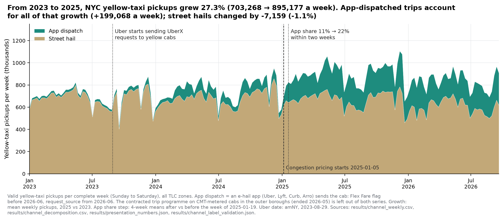

# Where the Growth Came From: App Dispatch and NYC Yellow Cabs, 2023–2026

*NYC Taxi & Limousine Commission (TLC) trip records, 2023-01 → 2026-09, by TLC zone. Every number links to the file under `results/` it comes from; every judgement call is in [`DECISIONS.md`](../DECISIONS.md). Details are in the [appendix](appendix.md).*

## Summary

**Three findings.**
1. **The shift.** From 2023 to 2025, NYC yellow-taxi pickups grew 27.3% (703,268 → 895,177 a week). App-dispatched trips account for all of that growth (+199,068 a week); street hails changed by −7,159 (−1.1%) ([channel_decomposition.csv](../results/channel_decomposition.csv), [presentation_numbers.json](../results/presentation_numbers.json)). In the congestion zone, the app share of yellow pickups rose from 2.3% (January 2023) to 29.6% (January 2026) ([channel_restatement.json](../results/channel_restatement.json)).
2. **Supply.** The growth came with more cabs, not busier cabs. From 2023 to 2025, trips per day rose 25.6% and active cabs per day 24.0%; trips per cab-day stayed between 14.0 and 15.0 ([presentation_numbers.json → supply](../results/presentation_numbers.json)).
3. **Forecasting.** A day-ahead forecaster frozen in December 2024 stayed accurate through the shift. Its error was 16.4%, against 16.2% with monthly retraining and 23.7% for a seasonal naive forecast ([adaptation_summary.json](../results/adaptation_summary.json)).

**What I tested and could not identify.** I could not identify whether app trips are additional, or what congestion pricing did to taxi demand. Eight of ten pre-registered designs stopped at their pass/fail check ([presentation_numbers.json → preregistered_checks](../results/presentation_numbers.json)). One passed and answers a narrower question; one passed partly, with an estimate that is not credible (section 4).

**Recommendation.** Evaluations and forecasts of NYC taxi demand in 2023–2026 must model the dispatch channel. A model that treats yellow pickups as one series reads a change in dispatch as a change in demand.

---

## 1. Data and definitions

- **Scale.** Over 1.2 billion trip records: 341,589,889 yellow-taxi records (2019-01 → 2026-09) and 904,683,847 high-volume for-hire vehicle (FHV: Uber, Lyft) trips ([presentation_numbers.json → scale](../results/presentation_numbers.json)). I processed them with DuckDB and dbt on one 12-core machine with 12.5 GB of memory ([machine_resources.json](../results/machine_resources.json)).
- **App dispatch.** An e-hail app (Uber, Lyft, Curb, Arro) sends a yellow cab to the rider. I identify it by the Flex Fare flag before June 2026 and by the `request_source` field from June 2026; on June–September 2026 the two agree on 99.97–100% of trips ([channel_label_validation.json](../results/channel_label_validation.json)).
- **Street hail.** Every other valid yellow pickup, except the contracted trip programme.
- **Congestion zone (CBD).** Manhattan south of 60th Street, 38 TLC zones. From 2025-01-05, taxis pay $0.75 and FHVs $1.50 per trip touching it.
- **Outer boroughs.** The Bronx, Brooklyn, Queens and Staten Island, airports excluded.
- **Contracted trip programme.** Centrally paid outer-borough trips recorded as street hails, ended May 2026; kept as its own series ([appendix A2](appendix.md#a2-the-contracted-trip-programme)).
- **Weeks.** All comparisons use mean weekly pickups, because calendar months hold four or five panel weeks.

## 2. The shift

**Citywide and by area.** Growth accounting, 2023 → 2025, mean weekly pickups ([channel_decomposition.csv](../results/channel_decomposition.csv)):

| Area | Change in total | From app trips | From street hails |
|---|---|---|---|
| All zones | +191,909 (703,268 → 895,177) | +199,068 | −7,159 |
| CBD | +99,063 (418,560 → 517,623) | +104,958 | −5,896 |
| Manhattan outside the CBD | +50,537 (215,677 → 266,214) | +51,230 | −692 |
| Outer boroughs | +43,526 (8,277 → 51,803, about six-fold) | +42,811 | +715 |

**The app share rose in steps** ([channel_label_validation.json → flex_share_steps](../results/channel_label_validation.json); [F6a](figures/F6a_channel_areas.png)). Across all zones it jumped by 5.6 points at the week of 2024-02-25, 5.4 at 2024-09-01, 10.9 at 2025-01-19 and 7.2 at 2025-05-04. The largest step came two weeks after congestion pricing began, so I checked it by area ([presentation_numbers.json → january_2025_step](../results/presentation_numbers.json)):

| Area, week of 2025-01-05 → 2025-01-19 | App pickups | Street hails |
|---|---|---|
| CBD | 45,477 → 110,403 | 353,851 → 381,403 |
| Manhattan outside the CBD | 22,160 → 45,729 | 207,590 → 207,913 |
| Outer boroughs | 9,572 → 26,123 | 4,785 → 4,654 |

- App pickups rose 2.1- to 2.7-fold within two weeks in every area, while street hails changed by −2.7% to +7.8%. The step mainly added recorded trips rather than relabelling street hails.
- The step was as large for trips that never touch the zone (+10.6 points) as for trips that do (+8.1 to +11.3) ([app_share_policy_step.json](../results/app_share_policy_step.json); [F6e](figures/F6e_app_share_step.png)). The fee difference between taxis and FHVs does not explain it.
- The cause of the step is not known from public sources.

**Where it happened** ([F4g](figures/F4g_app_dispatch_map.png)). Zones where Uber and Lyft dispatch is common are the zones where yellow pickups grew most. Growth from 2023 to 2025 correlates with the June–September 2026 Uber and Lyft share at r = 0.92 across 63 Manhattan zones and r = 0.90 across all 200 zones (Spearman 0.85) ([app_dispatch_summary.json](../results/app_dispatch_summary.json)). This is a correlation, not an effect.

**Supply** ([presentation_numbers.json → supply](../results/presentation_numbers.json), from the TLC's monthly reports). From 2023 to 2025, yellow trips per day rose 25.6% (104,422 → 131,133) and active cabs per day 24.0% (about 7,040 → 8,720). Trips per cab-day stayed between 14.0 and 15.0 in 2023–2026.

**The ride market in the CBD** ([presentation_numbers.json → cbd_ride_market](../results/presentation_numbers.json)), mean weekly pickups:

| | 2023 | 2025 |
|---|---|---|
| Yellow taxis | 418,560 | 517,623 |
| Uber + Lyft (FHV) | 1,234,000 | 1,164,607 |
| Total | 1,652,560 | 1,682,229 |
| Yellow's share | 25.3% | 30.8% |

The total was about flat (+1.8%) and yellow's share rose ([appendix A2](appendix.md#a2-the-contracted-trip-programme) gives the platforms' view).

## 3. A methods case: how a textbook DiD produced a −35% effect that was not there

A difference-in-differences (DiD) compares the change in treated zones with the change in control zones over the same weeks.

**The result.** My pre-registered DiD compared log(1 + weekly pickups) in the 38 CBD zones with 25 Manhattan control zones outside it, with zone and week fixed effects. It gave −34.6% [−47.7%, −18.3%], p = 0.0004 ([did_static.json → main](../results/did_static.json)). Dropping one zone at a time kept every estimate between −36.3% and −32.0%. It looked robust.

**Why it was wrong.** Equal zone weights let small uptown control zones drive the control trend ([F4b](figures/F4b_effect_map.png)). Their pickups grew several-fold, and they are the zones where app dispatch is highest: the fastest-growing control zones are 71–83% Uber/Lyft-dispatched ([figure_stats_phase4b.json → c1](../results/figure_stats_phase4b.json)), the median CBD zone 27% ([app_dispatch_summary.json](../results/app_dispatch_summary.json)). A log difference against fast-growing small zones reads their growth as a CBD decline. Weighting zones by their pre-policy volume gives −5.2% [−12.8%, +3.0%].

**How I caught it.**
1. **The pre-trend test failed** (p = 2.7e−10). This test checks whether treated and control zones moved in parallel before the policy. In simulations without a pre-trend the test rejects too often (9.5% at a 5% level, [appendix A6](appendix.md#a6-the-methods-case-test-size-and-the-forecast-check)), but nowhere near this p-value ([pretrend_test_size.json](../results/pretrend_test_size.json)).
2. **A model that knows nothing about control zones disagreed.** After the policy, CBD pickups ran +2.0% against the frozen forecaster ([figure_stats_phase4.json](../results/figure_stats_phase4.json); [F4d](figures/F4d_counterfactual_vs_did.png)).
3. **A placebo found an effect where there was none.** A placebo reruns the design where no effect can exist. The same specification at a fake policy date, 2024-01-07, a year early, gives −13.8% ([placebo.json → placebo_in_time](../results/placebo.json)).
4. **The control group's growth traced to the dispatch channel** (section 2).

**The lesson.** Before reading a DiD's p-value, check its weighting and what is growing in its control group.

## 4. What the data could not identify

Each pre-registered design had an expected direction and a pass/fail check, which I call a gate, fixed before it was run. Of 10 pre-registered designs, 8 stopped at their gate, 1 passed and 1 passed on three of four outcomes; the 2 designs I added after seeing earlier results failed too ([presentation_numbers.json → preregistered_checks](../results/presentation_numbers.json); [appendix A3–A5](appendix.md#a3-incrementality-of-app-trips)). Estimates of failed designs are not interpretable as effects.

| Question | Design | Pre-registered | Estimate | Gate |
|---|---|---|---|---|
| Congestion pricing and yellow demand | DiD, equal zone weights | yes | −34.6% | pre-trend p = 2.7e−10: fail |
| | DiD, zones weighted by volume | no | −5.2% | pre-trend p = 1.6e−17: fail |
| | Synthetic control | yes | −1.2% (rank 11 of 16 units) | fake-2024-date gap 0.045 above the pre-period fit 0.043: fail |
| Congestion pricing and trip speed | DiD against Manhattan outside the CBD | yes | +1.9% | pre-trend p = 1.1e−18: fail |
| | DiD against Brooklyn and Queens | yes | −4.0% | pre-trend p = 5.9e−46: fail |
| Congestion pricing and Uber + Lyft demand | DiD | yes | not estimated | pre-trend p = 2.3e−18: fail |
| Congestion pricing by channel | DiD, street hails | yes | −3.1% | pre-trend p = 9.7e−18: fail |
| | DiD, app trips | yes | +12.2% | pre-trend p = 2.4e−22: fail |
| Did the fee move trips into apps? | App-share step by trip type | yes | +8.1 to +11.3 points touching the CBD, +10.6 touching neither end | comparison needs no parallel trends: answered |
| | Event study of the app share (second reading, same design) | yes | +3.0 points | pre-trend p = 3.9e−27: fail |
| Lyft's entry on Curb cabs (preliminary) | DiD by vendor, levels | yes | −1.12 [−1.37, −0.87] | pre-trend p = 0.26 / 0.27 / 0.22 (total / app / street): pass; Uber trips p = 1.9e−13: fail. 3 of 4 outcomes pass |
| | DiD by vendor, logs (alternative) | no | 0.68 [0.09, 1.23] | pre-trend p = 2.3e−07: fail |
| Are app trips additional? | Double machine learning (DML) | yes | 0.90 [0.74, 1.06] in the CBD | lead placebo fails in Manhattan outside the CBD (p = 9.8e−05): fail |

Neither of the two that passed identifies an effect. The step comparison shows the January 2025 step as large for trips that never touch the zone; it does not measure demand. Lyft's levels estimate is not credible: Curb cabs carry about 4.4 times CMT's weekly pickups, so common percentage swings appear as level changes ([presentation_numbers.json → lyft_curb_cmt_ratio](../results/presentation_numbers.json)).

DML fits flexible models for both the outcome and the treatment and estimates the effect from what neither explains. Its lead placebo tests whether next week's app trips "predict" this week's street hails; they should not. Estimates of the share of app trips that are additional range from 0.52 to 2.62 across estimators in the CBD; the primary DML gives 0.90 [0.74, 1.06]; the estimators disagree beyond their intervals and the lead placebo fails in Manhattan outside the CBD, so incrementality is not identified from these data ([incrementality_dml.json](../results/incrementality_dml.json); [F6c](figures/F6c_incrementality.png)).

## 5. Forecasting through the shift

WAPE, the error measure, is the sum of absolute errors divided by the sum of actual pickups.

**Accuracy.** On 2024 day-ahead forecasts for the 103 zones that carry 99.04% of pickups ([modeled_zones.json](../results/modeled_zones.json)), Chronos-2 zero-shot with past weather had a WAPE of 16.5% and a tuned LightGBM 16.7%; a paired bootstrap cannot tell them apart. Both have about 31% lower error than the seasonal naive (24.1%) ([forecast_summary.json](../results/forecast_summary.json), [presentation_numbers.json](../results/presentation_numbers.json); [F2](figures/F2_model_comparison.png)).

**Robustness.** I froze the LightGBM in December 2024 and compared it with retrained versions on forecasts from February 2025 to September 2026. Over that time the CBD app share rose from about 18% to about 30% ([channel_restatement.json](../results/channel_restatement.json); [adaptation_summary.json](../results/adaptation_summary.json), [adaptation_gaps.csv](../results/adaptation_gaps.csv); [F5](figures/F5_adaptation.png)):

| Strategy | WAPE, all zones | WAPE, CBD | Bias, % of pickups |
|---|---|---|---|
| Frozen model | 16.4% | 15.4% | −2.3% |
| Monthly retrain | **16.2%** | **15.1%** | −1.7% |
| Chronos-2 zero-shot | 16.5% | 15.4% | −2.0% |
| Monthly retrain + app-share features | 16.8% | 15.7% | −2.9% |
| Seasonal naive (reference) | 23.7% | 22.3% | −0.1% |

The forecaster stayed accurate through the shift, and monthly retraining recovers a small, measurable gain: 0.23 points, with a 95% interval that excludes zero. The gain comes from retraining, not from the training window ([appendix A7](appendix.md#a7-forecasting-details)).

**Where the frozen model fails.** Its under-forecast sits where app growth is largest: −10.8% of pickups in the outer boroughs against −2.0% in the CBD ([adaptation_summary.json → bias_pct_of_pickups](../results/adaptation_summary.json)). Monthly retraining cuts it to −7.0% there. App-share features cut it furthest, to −6.0%, yet that strategy is the least accurate overall.

**Monitoring.** A cumulative-sum (CUSUM) monitor of daily forecast errors found no CBD-specific break at the policy date. In the first four weeks, pickups ran 6.3% above the frozen forecast in the CBD and 5.3% above elsewhere ([figure_stats_phase3.json](../results/figure_stats_phase3.json); [F3](figures/F3_error_over_time.png)). The first CBD alarm, on day 14, resembles the one alarm of the 2024 calibration year. The two 2026 alarms follow snowstorms of 7.5 and 5.5 inches, on days when CBD pickups ran 50.6% and 72.7% below forecast ([alarm_weather_check.csv](../results/alarm_weather_check.csv)).

**Recommendation for the forecasting system.** Retrain monthly on a sliding 24-month window; a refit takes a median of 384 s on 12 CPU cores ([adaptation_summary.json → retrain_cost](../results/adaptation_summary.json)). Do not add app-share features in their trailing form.

## 6. How to measure it properly: a switchback experiment

Geography cannot be randomized for a cordon toll, but app dispatch can be ([experiment_design.json](../results/experiment_design.json)). In a switchback, a platform or the TLC switches dispatch eligibility on or off at random by pickup zone and 2-hour block, across the 67 zones of the CBD and Manhattan outside it. The additional share is θ = (total pickups when on − when off) / app pickups when on. With the noise of March–May 2026, estimating θ to ±0.1 at 5% size and 80% power needs 3,756–5,922 zone-blocks, about 5–7 days.

## 7. Limitations

- **Coverage.** Yellow-taxi demand only (FHV as aggregates); one city-wide weather point, used as if known in advance; no driver- or vehicle-level supply data.
- **Channel label.** Before June 2026 "app" rests on the Flex Fare flag, whose 2024 share exceeds a TLC statement of 5–10% in most months ([appendix A1](appendix.md#a1-data)); fee recording differs by vendor ([cbd_validation_trips.json](../results/cbd_validation_trips.json)).
- **Data gaps.** Two TLC source outages (2022-09-17/18 and 2023-09-21/24) are excluded from the monitors.
- **Causal claims.** No design identified an effect, and nothing here states a causal effect of app dispatch or of congestion pricing.

## 8. What I would do next

- Run the switchback above with a platform partner.
- Re-estimate Lyft's entry with more months (`make lyft-refresh`).
- Obtain medallion-level supply data to test whether app dispatch brought cabs back.

## References

- Cook, C., et al. (2025, rev. 2026). *The Network-Wide Effects of Congestion Pricing: Evidence from New York City.* NBER Working Paper 33584. https://www.nber.org/papers/w33584. Road speeds from Google Maps data.
- Li, D., Zhuang, D., Li, Y., Shen, C., Cao, N., Zheng, Y., Wang, S., & Zhao, J. (2026). *Public transit gains and spatially uneven travel demand changes after NYC congestion pricing.* arXiv:2606.17530. https://arxiv.org/abs/2606.17530. Counterfactual demand forecasts from time-series foundation models.
- Pandey, A., Guler, I., & Gayah, V. (2026). *The Effect of the New York City Congestion Toll on Trips Served by Transportation Network Companies.* Findings. https://doi.org/10.32866/001c.155761. High-volume FHV trips, first 14 weeks of 2024 and 2025, DiD of log(1 + trips), CBD zones against Manhattan zones outside it.
- Zhang, Y., Sang, Y., & Wu, M. *Congestion Pricing in New York City: Effects on Ride-Hailing, Transit, and Welfare.* SSRN 5549128; also listed as "Congestion pricing in New York city: Effects on ride-hailing and transit" on ScienceDirect (S0965856426001072). Uber and Lyft trips and subway ridership.

**What overlaps and what is new.** These studies estimate congestion-pricing effects on road speeds, ride-hailing and transit over the first months. The CBD-versus-rest-of-Manhattan design is standard in this literature. With 24 pre-policy months, the same design fails its pre-trend test here, for yellow taxis and for high-volume FHV. New here are 20 post-policy months of yellow taxis, the dispatch-channel decomposition, and the forecasting-system view.
